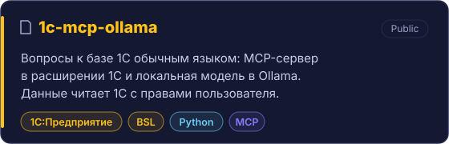
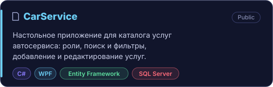

  

# Привет, я Kickfok

Разработчик 1С. Пишу доработки на БСП для ERP, Комплексной автоматизации и Документооборота, связываю
базы между собой и с внешними системами. Последнее время подключаю к 1С локальные языковые модели так,
чтобы данные не уходили из сети, а права пользователя соблюдались. Пишу и на C#, когда задаче нужно
настольное приложение.

## 📌 Проекты

  
  

## Чем занимаюсь

- **Доработки 1С на БСП.** Отчеты на СКД, формы, обработки, расширения без правки типовой конфигурации,
  права через профили групп доступа.
- **Интеграции.** HTTP-сервисы, обмены и загрузки между ERP, Документооборотом и внешними системами.
  Сложный обмен сначала собираю прототипом на Python, затем переношу на BSL.
- **Локальные LLM для 1С.** MCP-сервер в расширении, модель в Ollama, инструменты, которые читают базу с
  правами того, кто спросил.
- **C# и .NET.** Настольные приложения на WPF с Entity Framework и SQL Server.

## Как работаю

- Проверяю до сдачи: SonarQube без новых замечаний, тесты, прогон на копии рабочей базы.
- Документацию пишу вместе с кодом: инструкции пользователя и администратора, снимки экрана, история
  изменений.
- Типовую конфигурацию не трогаю, если задача решается расширением.

## Стек

